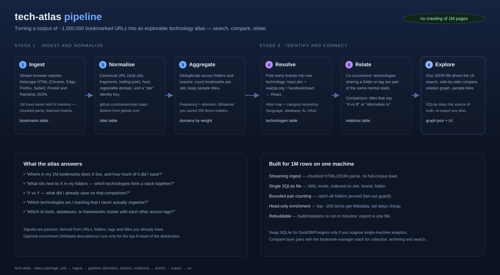

# tech-atlas

Turn a large bookmark corpus (~1,000,000 URLs) into a **technology atlas** you can
search, compare, and explore — without crawling a million pages.

The idea: the bookmarks you already saved are a rich, pre-curated signal.
Folders and tags cluster technologies the way *you* think about them; titles
record the comparisons you already made ("X vs Y"); counting shows what actually
matters to you. tech-atlas extracts all of that into a small, queryable store.



## What it answers

- Where in the corpus does technology X live, and how much of it was saved?
- What sits next to X — which technologies form a stack together?
- X vs Y — what was already saved on that comparison?
- Which technologies cluster across tags (AI tools, databases, frameworks …)?

## Quick start (bundled demo)

```bash
cd tech-atlas
python run.py demo        # ingest sample → build → export
```

Then open **`ui/index.html`** in a browser (double-click works). You get:

- searchable technology list with bookmark/domain counts,
- a detail panel with related technologies and sample links,
- a compare tray (up to 3, side by side + shared connections),
- a relation graph (node size = bookmarks, edges = co-occurrence).

## Using your real bookmarks

Export from your browser / service, then:

```bash
# 1) ingest one or more exports (HTML or JSON, repeatable)
python run.py ingest "bookmarks.html" "pocket.json" "raindrop.json"

# 2) derive sites → technologies → relations
python run.py build

# 3) (optional) enrich top ~200 technologies from Wikidata
python run.py enrich --limit 200

# 4) export for the UI
python run.py export --out ui/data/graph.json
```

Supported inputs: Netscape bookmark HTML (Chrome, Edge, Firefox, Safari),
Pocket/Raindrop/Pinboard-style JSON arrays (url/title/tags/folder/timestamp).

## How it works

| Stage | What happens | Table |
|---|---|---|
| **Ingest** | Stream HTML/JSON exports in chunks; dedupe canonical URLs | `bookmarks` |
| **Normalise** | Canonical URL (utm-stripping), host, registrable domain, `site` key | `bookmarks` |
| **Aggregate** | One row per site, bookmark counts, sample titles | `domains` |
| **Resolve** | Fold brands into technologies: `react.dev` + `reactjs.org` + `facebook/react` → `react` | `technologies` |
| **Relate** | Co-occurrence (shared folder/tag) + explicit "A vs B" pairs | `tech_relations` |
| **Export** | Single `graph.json` (+ `graph.js` for `file://` use) drives the UI | `ui/data/` |

Key design decisions:

- **Passive signals first.** URL, folder, tag, title carry most of the value.
  Nothing is fetched per-bookmark; enrichment is a separate, optional step for
  the head of the distribution only.
- **Repo-level identity.** `github.com/owner/repo` is kept distinct from
  `github.com` so libraries inside code hosts don't collapse together.
- **Fan-out guard.** A folder/tag containing hundreds of technologies is a
  catch-all; it gets pruned before pair counting so relations stay meaningful.
- **Alias folding, not magic.** `seed/aliases.json` and `seed/categories.json`
  are plain files you can edit when a merge or split is wrong.

## Built for 1M rows on one machine

- Streaming ingest: chunked parse + batched inserts (5k rows/txn), never a full-corpus load.
- SQLite (WAL) with indexes on `site`, `brand`, `folder` — single portable file.
- Pair counting is SQL-side (temp tables), pruned by context size, thresholded by weight.
- Enrichment bounded to top-N (Wikidata, cached in `cache/wikidata.json`).
- Everything rebuildable: re-run `build` / `export` in minutes.

Outgrown? Swap SQLite for DuckDB or Postgres — the pipeline is plain SQL.

## Project layout

```
tech-atlas/
├─ run.py                  # CLI entry: ingest | build | enrich | export | stats | demo
├─ atlas/
│  ├─ urls.py              # URL canonicalisation + site identity
│  ├─ ingest.py            # Netscape HTML + JSON parsers
│  ├─ db.py                # schema + light migrations
│  ├─ pipeline.py          # ingest → domains → resolve → relations
│  ├─ relations.py         # co-occurrence + vs-pairs
│  ├─ resolve.py           # alias folding, display names, categories
│  ├─ enrich.py            # optional Wikidata (cached)
│  └─ export.py            # graph.json / graph.js
├─ seed/                   # editable alias + category maps
├─ sample_data/            # demo export
├─ ui/index.html           # search / compare / graph — opens via file://
└─ docs/pipeline.svg       # this pipeline diagram
```

## Extending

- **New signal:** parse `README`/`awesome-*` lists from saved repos; add keywords → new relation kind.
- **Embeddings:** cluster titles/folders (Ollama or any local model) to auto-group the long tail.
- **More comparisons:** the `alternative` relation feeds a direct "X vs Y" view in the UI.
- **Collection layer:** pairs with a bookmark-manager stack (browser extension, archiver,
  search index) — that system collects and stores; tech-atlas reads its export.

## Notes

- Python 3.9+ only; no third-party dependencies required (stdlib + SQLite).
- `ingest` is idempotent per URL (canonical dedupe) but re-running over the same
  file after a `build` duplicates nothing; to start over, delete `atlas.db`.
- Verified end-to-end on the bundled sample: 63 bookmarks → 55 sites → 54
  technologies → 205 relations, exported and rendered in the UI.
